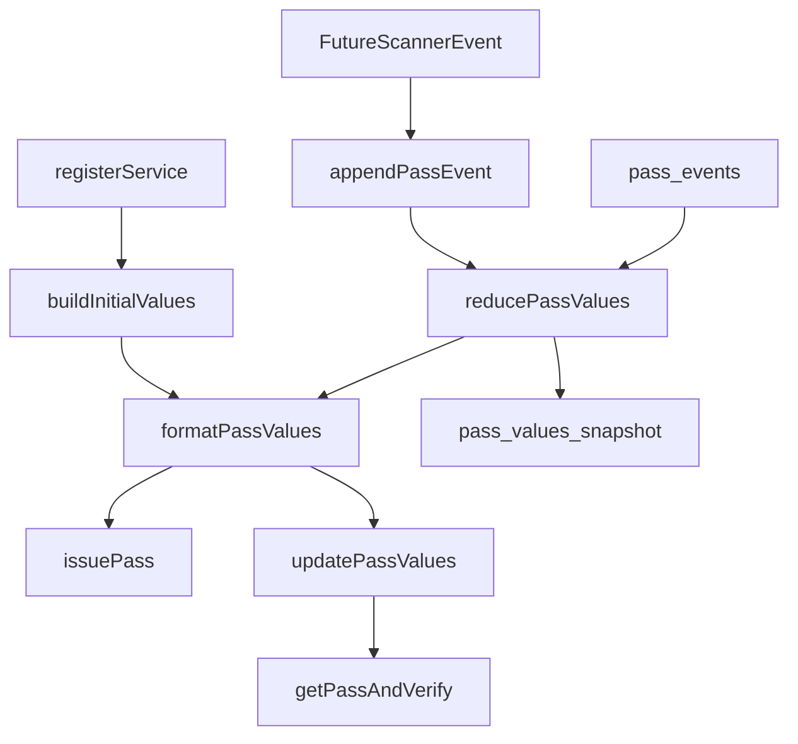

# Roadmap：Pass Runtime Values（最終裁決）

- **日期**：2026-10-24
- **狀態**：進行中
- **影響範圍**：`packages/shared/`、`apps/backend/src/modules/pass-templates/`、`apps/backend/src/shared/lib/passcreator/`、`apps/frontend/src/components/business/dashboard/CardBuilderEditor/CardPreview/`、`supabase/migrations/`

本檔是六份討論計畫的**權威索引**。原始計畫保留作歷史，不刪除；本檔明確標示取代關係，避免後續 agent 誤讀舊方向。

## 最終裁決：共同終點是「共用 Pass runtime value 領域模組」

不是單一檔案，而是一組共用模組：

| 檔案 | 職責 |
|---|---|
| `packages/shared/logic/passValueCalculator.ts` | 初始狀態建立 + 事件還原（`buildInitialValues()` / `reducePassValues()`） |
| `packages/shared/logic/passFieldFormatter.ts` | canonical state → Passcreator typed payload |
| `packages/shared/schemas/passValues.ts` | 事件 / 快照 Zod 契約 |
| `packages/shared/logic/passExpiry.ts` | membership / coupon / discount 統一期限規則 |

核心不變式：

1. **業務公式與顯示文字分離** — state 不使用含糊的單一 `balance` 欄位；`giftPoints`、`pointsBalance`、`carryoverBalance`、`spendAccumulated` 語意分開。
2. **Preview 維持模板示意** — preview 不承載持卡人 runtime 真值（保留「preview 維持 demo、首次簽發送真值」）。
3. **Shared 保持純函式** — 無 Web API、無 DB、未來可直接用於 React Native。
4. **`public.pass_events` 是唯一 source of truth** — `pass_holders.pass_values_snapshot` 只是可重建的衍生快照。

## 六份舊計畫的取代關係

| 舊計畫 | 裁決 | 說明 |
|---|---|---|
| `pass-value-calculator_1bd5bb1b` | **保留為主軸**（已修正） | 修正三處：模板設定來源改讀 `templates.settings` 完整 JSONB、wire payload 改用 `PasscreatorPassValues`（非舊計畫的 `{headerFields, secondaryFields}` 抽象）、同步失敗改為「帳本不回滾 + 以 snapshot 重推」 |
| `pass-holder-counter-model_bdec14f8` | **完全 superseded** | 不採獨立 counter table，也不讓 preview 讀持卡人真值 |
| `pass-holder-counter-model_9fbdc4c7` | **部分保留** | 保留「preview 維持 demo、首次簽發送真值」；獨立 counter table 淘汰 |
| `balance-carryover-semantics_64a14f71` | **移至 Scanner 後續** | `N − M` 語意在 Scanner 計畫決定；本輪不建 balance table，也不先改 cashback 槽位 |
| `preview_branch_consolidation_fd61857b` | **被取代** | 由較新的 `header-slot-single-source` 方案取代 |
| `header-slot-single-source_ce9d1892` | **採作 foundation Phase 1** | 保留 render behavior 測試；只取代重複契約測試 |

## 執行順序

| Phase | 內容 | 完成條件 |
|---|---|---|
| 0 | Decision Log + Roadmap 索引 | 本檔 + Decision Log 落盤 |
| 1 | Header slot 單一來源 | `packages/shared/constants/headerSlots.ts` 建立；`passCardPreviewSlot.ts` / `PassCardPreviewHeader.tsx` 共用 resolver；render behavior 測試全綠 |
| 2 | Shared 純函式與契約（TDD） | `passValues.ts` / `passValueCalculator.ts` / `passFieldFormatter.ts` / `passExpiry.ts` + 測試；8 卡種覆蓋 |
| 3 | Migration 028 | `public.pass_events` + `pass_holders.pass_values_snapshot` 已 apply；registry 已更新；`check:migrations` 綠 |
| 4 | Passcreator V3 PATCH client | `updatePassValues()` + conformance tests（method／URL／只送指定欄位／date format／non-ASCII）|
| 5 | Backend 狀態層與同步 service | `db/passEvents.ts` + `services/passValueService.ts`；四層契約同步；conformance test 綠 |
| 6 | 註冊接線與既有資料回填 | 註冊初始值隨首次簽發送出；idempotent backfill 先 dry-run 再執行 |
| 7 | 驗證與交付 | typecheck / lint / test / check:migrations / verify:i18n 全綠 + code review + production smoke |

## 本輪邊界

**做**：共用模組、註冊初始值、DB event ledger／snapshot、Passcreator PATCH、既有資料 backfill。

**不做**：Scanner API、Scanner ingestion、完整 scanner 業務語意。

**不建立**：`pass_holder_counters`、`pass_holder_balances`。Scanner 計畫解除 blocked 前不建立。

## Scanner 後續計畫（blocked）

見 `runs/plans/2026-10-24-pass-scanner-event-semantics.md`。解除 blocked 的前提條件：

- Scanner 交易來源與 canonical event variants（visit / stamp / points / spend / coupon redemption / refund）
- 同日首次 +1、同日重複不累計、request replay 冪等、外部 transaction id 去重
- `N − M` carryover 的正式 event 與 reducer；cashback 是否退出 `balance` 槽位
- Scanner API、交易入庫與 event append 的原子邊界
- PATCH failure 的 queued retry / manual resync、mandatory GET read-back verification

## 相關文件

- `runs/decisions/2026-10-24-pass-runtime-value-model.md` — 三段式決策紀錄
- `runs/plans/2026-10-24-pass-scanner-event-semantics.md` — blocked 的 Scanner 後續計畫
- `runs/decisions/2026-10-23-gift-card-paid-registration.md` — 贈品卡購買流程（`purchased_points` / `gift_card_snapshot` 來源）
- `runs/decisions/2026-10-19-pass-holder-v3-issuance.md` — Passcreator V3 發行流程
