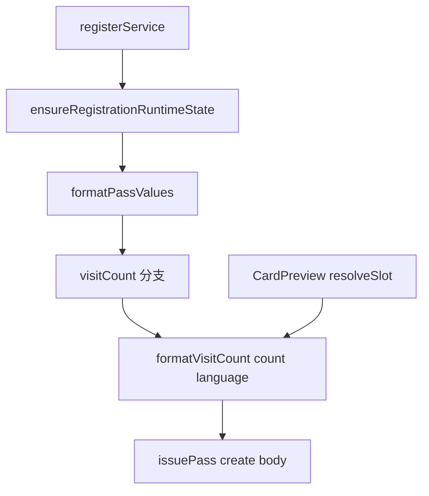

# Visit Count 數值+單位包裝（Wallet 顯示「5 次 / 5 times」）

- **日期**：2026-10-27
- **狀態**：**待實作** — 尚未開始（待 user 確認後啟動）
- **影響範圍**：`packages/shared/logic/`、`packages/shared/constants/`、`apps/backend/src/modules/pass-templates/`、`apps/backend/src/shared/lib/passcreator/`、`apps/frontend/src/components/business/dashboard/CardBuilderEditor/CardPreview/`、`apps/frontend/src/i18n/locales/`

## 目標

`/pass/{templateID}` 註冊後的 Wallet pass，綁定 `visitCount` 槽位時顯示 **「5 次」(zh-TW) / 「5 times」(en)**，單位依 `templates.settings.language` 決定。編輯器預覽與模板庫預覽用**同一條 formatter**，不與 Wallet 漂移。

## 現況（已驗證）

- `packages/shared/logic/passFieldFormatter.ts` `FACE_FIELD_METRIC.visitCount = 'visitCount'` → 現在送裸數字（`0` / `n`）
- `packages/shared/constants/card-fields.ts` `visitCount.semanticType = 'number'` → Passcreator template 宣告該槽位為 `number`；送字串會整包 400（同折扣槽位事故型態）
- 預覽目前是 i18n 靜態字串 `apps/frontend/src/i18n/locales/passCard.zh-TW.ts`（`fieldPreview.visitCount.value = '5 次'`）/ `passCard.en.ts`（`'5 times'`）
- 折扣等級線已建立完整樣板（`packages/shared/logic/spendTier.ts` 的 `formatTierAmount` / `formatTierPercent` + semanticType 降級 + `DISCOUNT_TYPE_DOWNGRADED_FIELDS` 400 fallback），本計畫沿用同一形狀

## 資料流



## 決策（4 條）

1. **單位字寫在 shared logic leaf module，不進 shared/i18n 字典** —— 沿用 `packages/shared/logic/spendTier.ts` `formatTierAmount` 先例（「數值+單位」是 display logic，不是 UI 文案）；避免 shared/i18n 額外 drift 面。`zh-TW → '次'`、`en → 'times'`，用 exhaustive switch，未來加語系會編譯失敗逼決策。
2. **`visitCount.semanticType` 由 `number` 降為 `text`** —— 值變成打包字串後，舊模板仍宣告 `number` 會 400。同步把 `DISCOUNT_TYPE_DOWNGRADED_FIELDS` 改名為 `TYPE_DOWNGRADED_TEXT_FIELDS` 並加入 `visitCount`（現行名稱會失真）。既有模板在重推 Step 8 前，visitCount 槽位走 400 fallback 被丟棄（degraded），其餘槽位照常同步。**影響面比折扣槽位大**：visitCount 是 common 欄位，所有綁了它的模板都算。
3. **預覽與 Wallet 共用同一 formatter** —— 預覽值改為 `formatVisitCount(5, templateLanguage)`；label 仍走 i18n（與折扣槽位同一形狀：label 取 app locale、value 取 template language）。
4. **不動 metric 與 DB** —— `snapshot.metrics.visitCount` 維持整數，snapshot schema 不改，不新增 migration。

## 執行步驟

| # | 步驟 | 內容 |
|---|---|---|
| 1 | shared formatter | 新增 `packages/shared/logic/visitCount.ts` formatter + `packages/shared/constants/visitCountPreview.ts` demo 常數 + barrel exports + `package.json` exports + Rule 016 九 surface 同步（3 個 config alias） |
| 2 | shared 型別降級 | `visitCount` semanticType `number`→`text`；`DISCOUNT_TYPE_DOWNGRADED_FIELDS` 改名 `TYPE_DOWNGRADED_TEXT_FIELDS` 並加入 `visitCount`；`v3-pass.ts` 引用同步 |
| 3 | backend 接線 | `formatPassValues` 提升 language 層級 + 新增 visitCount 分支；`PassEventSyncTarget` 加 `language` / `currency` 並轉傳 |
| 4 | frontend 預覽 | `resolveSlot` 新增 visitCount 分支用 shared formatter；passCard locale 移除 `fieldPreview.visitCount.value` |
| 5 | 測試 | 更新 shared formatter/card-fields 分布、backend 400 fallback + create body、frontend ZAR 回歸斷言 |
| 6 | 文件 | Decision Log + feedback + INDEX 一列（與 code 同 commit） |
| 7 | 驗證 | typecheck ×3 + shared/backend/frontend 測試 + `check:migrations` + `check:oneoff` + `verify:i18n` |

## Phase 1 — Shared：formatter + 預覽 demo 常數

- 新增 `packages/shared/logic/visitCount.ts`（leaf module，只 type-import `PassLanguage`）：
  - `formatVisitCount(count: number, language: PassLanguage): string` → zh-TW `` `${count} 次` ``、en `` `${count} times` ``；非有限值回 `'—'`（與 `formatTierAmount` 的 `INVALID_VALUE` 同形狀）
- 新增 `packages/shared/constants/visitCountPreview.ts`：`VISIT_COUNT_PREVIEW_VALUE = 5`（沿用 `balancePreview.ts` / `discountPreviewAmounts.ts` 的「preview demo 值住 shared/constants」慣例）
- `packages/shared/logic/index.ts`、`packages/shared/constants/index.ts` 各加一行 barrel export
- `packages/shared/package.json` exports map 加 `"./logic/visitCount"`、`"./constants/visitCountPreview"`
- 新增 `packages/shared/logic/visitCount.test.ts`

### Rule 016 九個 surface 同步（動 config 前先跑該 rule 四條檢查）

| # | 檔案 | 動作 |
|---|---|---|
| 1 | `packages/shared/package.json` | exports 加 2 條 |
| 2 | `packages/shared/logic/index.ts` | barrel export |
| 3 | `packages/shared/constants/index.ts` | barrel export |
| 4 | `apps/backend/vitest.config.ts` | 加 `@saome/shared/logic/visitCount` 顯式別名（須在 generic 前） |
| 5 | `apps/frontend/vite.config.ts` | 加 logic + constants 兩條 regex 別名 |
| 6 | `apps/frontend/vitest.config.ts` | 加 logic + constants 兩條字串別名 |
| 7 | `apps/*/tsconfig*.json` | 確認 `@saome/shared/*` wildcard 已涵蓋（應不需改） |
| 8 | `package-lock.json` | 無新依賴 → 不動 |
| 9 | `.github/workflows/*.yml` | cache-dependency-path 不動 |

## Phase 2 — Shared：欄位型別降級 + 400 fallback 集合

- `packages/shared/constants/card-fields.ts`
  - `visitCount.semanticType`：`'number'` → `'text'`（附「值帶單位故為字串」說明）
  - `DISCOUNT_TYPE_DOWNGRADED_FIELDS` → 改名 `TYPE_DOWNGRADED_TEXT_FIELDS`，成員加入 `'visitCount'`，docblock 改寫
- `apps/backend/src/shared/lib/passcreator/v3-pass.ts`：import 與 2 處使用點跟著改名（create + patch 兩條 fallback 共用同一集合，行為不變）
- 全 repo grep 確認改名後無殘留引用（含 `runs/decisions/2026-10-27-pass-holder-spend-and-discount-tier.md` 的受影響檔案清單列）

## Phase 3 — Backend：formatter 接線

- `packages/shared/logic/passFieldFormatter.ts`
  - `formatPassValues` 內把 `const language = input.language ?? 'zh-TW'` 提升到函式層級（折扣分支與 visitCount 分支共用）
  - `FACE_FIELD_METRIC` 移除 `visitCount`（該 map 語意 = 裸 metric 讀取；`accumulatedSpendDiscount` 已有同款先例）
  - 新增 visitCount 分支：僅在 `boundFieldKeys` 綁定時寫入 `properties.visitCount = formatVisitCount(snapshot.metrics.visitCount, language)`；置於 discount 分支旁、generic loop 之前
- `apps/backend/src/modules/pass-templates/services/passRegistrationService.ts`：已傳 `language: input.settings?.language`，**不需改**
- `apps/backend/src/modules/pass-templates/services/passValueService.ts`：`PassEventSyncTarget` 加 `language` / `currency`（Scanner 事件 PATCH 路徑目前未帶語言，會落到 zh-TW 預設）；`applyPassEvent` 轉傳。`discountTier` 仍留待 Scanner 計畫（需 tier ladder + spend 解析，非本次範圍）

## Phase 4 — Frontend：預覽接線

- `apps/frontend/src/components/business/dashboard/CardBuilderEditor/CardPreview/passCardPreviewSlot.ts`：新增 `visitCount` 分支（置於 default 分支之前），value = `formatVisitCount(VISIT_COUNT_PREVIEW_VALUE, language ?? 'zh-TW')`，label 仍 `t('fieldPreview.visitCount.label')`
- `apps/frontend/src/i18n/locales/passCard.zh-TW.ts` / `passCard.en.ts`：`fieldPreview.visitCount` 移除 `value`（值改由 shared formatter 產生，避免兩個來源）；label 保留

## Phase 5 — 測試更新

| 檔案 | 調整 |
|---|---|
| `packages/shared/logic/visitCount.test.ts` | 新增：zh-TW `5 次`、en `5 times`、`0`、非有限值 `'—'` |
| `packages/shared/logic/passFieldFormatter.test.ts` | 更新受影響斷言：bound visitCount → 字串、unbound → 不輸出、`FACE_FIELD_METRIC` key 集合由 3 降為 2、「numeric metrics are emitted as JSON numbers」改為「visitCount 是字串、其他 metric 仍是數字」 |
| `packages/shared/constants/card-fields.test.ts` | semanticType 分布 text 8→9 / number 12→11；「typed text」清單加入 visitCount；集合改名後的引用 |
| `apps/backend/src/shared/lib/passcreator/v3-pass-update.test.ts` | 400 fallback 案例加入 visitCount（字串值被丟棄、其餘欄位照常送出、degraded=true） |
| `apps/backend/src/modules/pass-templates/tests/passValueService.test.ts` | `syncValuesToPasscreator` 的 visitCount 期望值由數字改字串 |
| `apps/backend/src/modules/pass-templates/tests/register.runtimeValues.test.ts` | 新增：綁定 visitCount 的模板 → create body 帶 `0 次` / `0 times` |
| `apps/frontend/src/components/business/dashboard/CardBuilderEditor/CardPreview/PassCardPreviewBody.test.tsx` | 既有 ZAR 污染回歸測試（原本斷言 raw key `visitCount.value`）改為斷言 formatter 輸出且無 `R` 前綴；補 en 語系案例 |

## Phase 6 — 文件（同 commit）

- 新增 `runs/decisions/2026-10-27-visit-count-unit-display.md`：三段式（背景 / 選項與決定 / 影響），重點記錄「visitCount 由裸數字改打包字串」+「semanticType 降級 + 舊模板需重推 Step 8」+「單位字置 shared logic 而非 i18n 字典」三個決策
- 新增 `runs/improvements/feedback/20261027-visit-count-unit-display.md`
- `runs/improvements/INDEX.md` 加一列

## Phase 7 — 驗證（Rule 006）

```
npm run typecheck --workspace=packages/shared
npm run typecheck --workspace=apps/backend
npm run typecheck --workspace=apps/frontend
npm test --workspace=packages/shared
npm test --workspace=apps/backend
npm test --workspace=apps/frontend
npm run check:migrations --workspace=apps/backend
npm run check:oneoff
npm run verify:i18n
```

> 前端測試有 10 條既有 timing flake（LoginForm / RegisterForm / PassHolderRegistration / MediaAssetUploader，5 秒 timeout）；本計畫只動 `CardPreview` 相關檔案，驗證時以 targeted 檔案結果 + 全套 baseline 比對。

## 明確不做（列為後續）

- **Scanner 消費事件後重算等級 / visitCount** —— `runs/plans/2026-10-24-pass-scanner-event-semantics.md` 仍 blocked；本次只處理註冊時的格式
- **`PassEventSyncTarget.discountTier`** —— 事件 PATCH 路徑帶折扣等級需 tier ladder + spend 解析，屬 Scanner 計畫
- **其他計數槽位**（`availableRewards`「2 次」/ `totalStamps` / `stampsRemaining` / `currentPoints`「23點」/ `couponRemainingCount`）—— 目前皆非 runtime metric 或另有語意，逐一另案處理
- **既有模板補發** —— 舊模板 visitCount 槽位在重推 Step 8 前走 400 fallback（degraded），不做 bulk PATCH

## Commit

本計畫的實作為**獨立 commit**（visit count code + test + feedback + Decision Log + INDEX row 同 commit，依 Rule 011）。

前序兩條線已各自 commit，工作樹無跨 session 未提交的重疊：

- 會員等級 snapshot 線 → `6833aa6 feat(pass-holder): derive membership tier snapshot server-side`
- 折扣等級線 → `d3e3525 feat(pass-holder): land discount tier and spend on the holder row`

先前計畫中提到的「`packages/shared/logic/index.ts` / `packages/shared/package.json` / `apps/backend/vitest.config.ts` 三檔同時含另一 session 的改動、staging 需逐 hunk 挑選」已隨上述兩個 commit 解除 —— 本計畫可直接改這三檔，不需挑 hunk。
